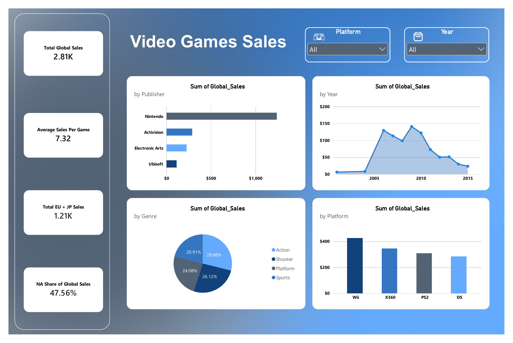

# Video Games Sales Analysis | Excel & Power BI

Explore historical global video game sales using **Excel for data cleaning and PivotTables** and **Power BI for dashboard visualisation**. The analysis compares games, publishers, platforms, genres and years in a dataset covering releases from 1980 to 2016.



**Workflow:** Raw data → Excel preparation and PivotTables → Power BI dashboard → insights

## 📊 Project overview

The goal is to explore how recorded video game sales differ across **regions, platforms, genres, publishers and release years**. This is a portfolio analysis of a historical dataset, not a picture of today's games market.

## 🛠️ Tools and workflow

| Tool | How it was used |
|---|---|
| **Microsoft Excel** | Raw-data review, cleaning, calculated fields, reference lookups, PivotTables and summary analysis |
| **Microsoft Power BI** | Interactive dashboard, charts, KPIs and year/platform filtering |

The Excel workbook contains three documented worksheets:

| Worksheet | Purpose |
|---|---|
| `Raw Data` | Original records |
| `Cleaned Data` | Prepared fields such as title categories, sales groups and publisher references |
| `PivotTable` | Summary tables for exploratory analysis |

## Dataset

The dataset contains historical video game records with these fields:

| Column | Description |
|---|---|
| `Rank` | Overall sales rank in the dataset |
| `Name / Game` | Video game title |
| `Platform` | Release platform |
| `Year` | Release year |
| `Genre` | Game genre |
| `Publisher` | Publishing company |
| `NA_Sales` | Sales recorded in North America (millions) |
| `EU_Sales` | Sales recorded in Europe (millions) |
| `JP_Sales` | Sales recorded in Japan (millions) |
| `Other_Sales` | Sales recorded in other regions (millions) |
| `Global_Sales` | Worldwide sales recorded in the dataset (millions) |

The original dataset link is not yet documented in this repository. Add the source URL and applicable terms when available.

## 🖥️ Power BI dashboard

The dashboard preview above shows the project's reporting layer. It focuses on:

**Key metrics**
- Total recorded global sales
- Average recorded sales per game
- Combined EU and Japan sales
- North America's share of global sales

**Visual analysis**
- Publisher ranking by recorded global sales
- Recorded sales by release year
- Sales distribution across genres
- Leading platforms by recorded sales

**Interactive filters:** Platform and release year.

> The PNG above is a **preview**, not the interactive report. An editable Power BI report requires a `.pbix` file; a link to that file is not currently documented in this README.

## 📈 Key findings

The project's existing analysis reports these patterns **within the historical dataset**:

- **Nintendo** ranks first among publishers by recorded global sales.
- Recorded sales activity is strongest around **2005–2010**, before declining later in the covered period.
- **Wii** is among the highest-selling platforms in the sample.
- **North America** represents approximately **47.5%** of recorded worldwide sales.

These are descriptive observations, not causal findings or predictions of current market performance.

## Excel data preparation

The `Cleaned Data` worksheet documents work including:
- Trimming and standardising game titles
- Creating categories based on release year and recorded sales
- Using publisher reference lookups
- Calculating game counts by publisher and yearly sales summaries
- Summarising results with PivotTables

## How to explore

1. Open [`VideoGamesSales.xlsx`](VideoGamesSales.xlsx) in Microsoft Excel.
2. Inspect `Raw Data`, `Cleaned Data` and `PivotTable` to follow the preparation and summaries.
3. View [the Power BI dashboard preview](dashboard_preview.png).
4. To inspect or edit the interactive Power BI report, open its `.pbix` file in Power BI Desktop **if that file has been shared**.

## Repository files

```text
├── VideoGamesSales.xlsx      # Data, preparation and PivotTables in Excel
├── dashboard_preview.png     # Power BI dashboard preview
└── README.md                 # Project documentation
```

The tree above lists files documented here; it does not claim that the editable Power BI source file is included.

## Limitations and reuse

- The dataset is **historical (1980–2016)**; results should not be presented as current market trends.
- Sales comparisons reflect this dataset's coverage and definitions, not necessarily all games or sales channels.
- A direct original-data citation and its redistribution terms should be added before claiming complete reproducibility or permission to redistribute the data.
- This project is presented for education and portfolio review; that statement does not grant a licence to third-party data.
